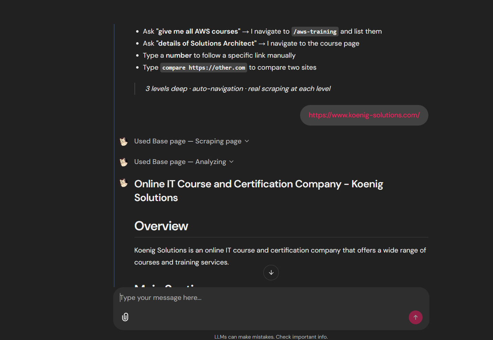
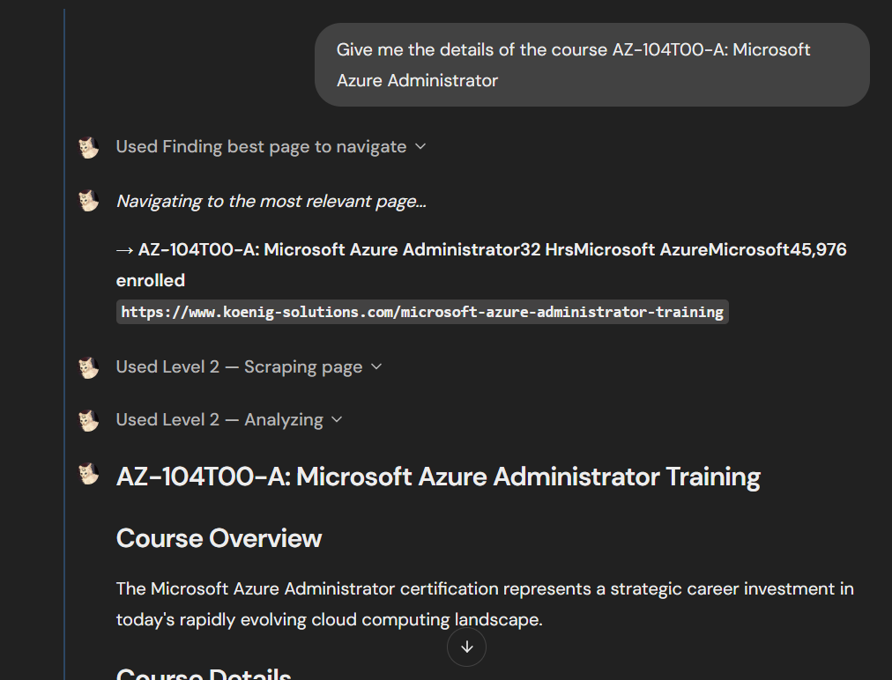
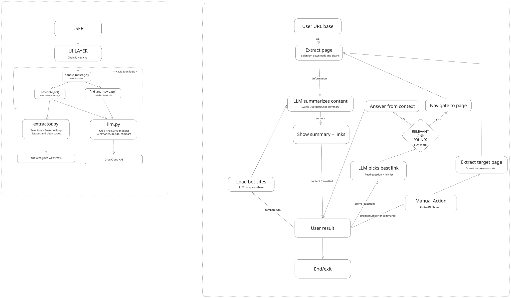

# DeepBrowse AI

**A multi-level web research agent.** Paste a URL and the agent scrapes the page with headless Chrome, summarizes it with a Llama model served by Groq, and lets you go deeper, either by picking a numbered link or by simply asking a question: it chooses the most relevant link and navigates there for you.

Built as a capstone project for the *AI-First Engineering with Generative & Agentic AI* course (Koenig Solutions).

## Screenshots





## Features

- **Scraping:** headless Selenium + BeautifulSoup, with scrolling to load lazy content and cleanup of menus, banners, popups and scripts.
- **Page-aware summaries:** different prompts for course pages, category pages and generic pages.
- **Question-driven navigation:** a keyword match over cached links first, then an LLM "link picker" (`llama-3.1-8b-instant`) as a fallback.
- **Up to 3 levels deep**, with breadcrumb, page cache and short chat history per session.
- **Commands:** paste a URL to start, type a number to follow a link, `back`, `home`, and `compare <url>` to compare two sites.
- **Chainlit UI**, plus two console scripts (`main.py`, `agent_simple.py`) for quick tests.

## How it works

```
URL / question
   -> extractor.py   (Selenium + BeautifulSoup: clean text + internal links)
   -> llm.py         (Groq: llama-3.3-70b for summaries, llama-3.1-8b for link choice)
   -> app.py         (Chainlit handlers + navigation state)
```

| File | Role |
|---|---|
| `app.py` | Chainlit app: prompts, navigation logic, session state |
| `extractor.py` | Page scraping, text cleanup, link extraction and ranking |
| `llm.py` | Groq client wrapper with token logging and optional API-key rotation |
| `agent_simple.py` | Minimal console version (summarize one URL) |
| `main.py` | Console extractor test (no LLM) |




## Getting started

**Requirements:** Python 3.10+, Google Chrome, and a [Groq API key](https://console.groq.com/).

```bash
git clone https://github.com/<your-user>/browser-agent.git
cd browser-agent

python -m venv venv
source venv/bin/activate        # Windows: venv\Scripts\activate
pip install -r requirements.txt

cp .env.example .env            # then add your Groq key(s)
chainlit run app.py
```

Open http://localhost:8000 and paste a URL, optionally followed by a question on the next line:

```
https://www.koenig-solutions.com/
What Microsoft Azure courses are available?
```

## Limitations

- **Tuned for training-catalog sites.** Page-type detection, link ranking and some HTML cleanup rules were written around the Koenig Solutions website. Other sites get a generic summary.
- **LLM answers can be wrong or incomplete.** Answers are generated from truncated page text, with no automated evaluation yet.
- **Not hardened for public deployment.** It fetches any URL a user provides and sends page content to a third-party API (Groq). It does not check `robots.txt`, so use it only on sites you are allowed to scrape.
- Scraping and LLM calls are synchronous, so one slow request blocks the app.

## Roadmap

- [ ] Evaluation set (questions with known answers) to measure accuracy
- [ ] Guardrails against prompt injection from scraped content
- [ ] Async scraping and LLM calls
- [ ] URL validation and `robots.txt` checks
- [ ] Deployment on AWS

## Author

Armando Tintore - [LinkedIn](https://linkedin.com/in/Armando-Tintore)
